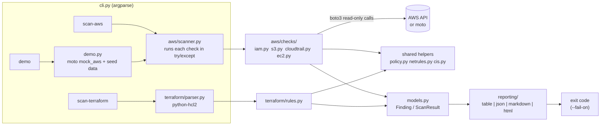

# cloud-guard

A small, read-only **AWS cloud security posture scanner** plus a **Terraform (IaC) static checker**, with findings mapped to the **CIS AWS Foundations Benchmark v3.0.0**.

> This is a learning / portfolio project. It is deliberately small (about 2,000 lines of Python excluding tests, much of it comments and docstrings) so every line can be read and explained. For production use, see the comparison with Prowler and Checkov below.

---

## The problem

Most cloud breaches are not caused by clever zero-days. They come from **misconfiguration**: a public S3 bucket, an admin policy with `"Action": "*"`, an access key that has not been rotated in two years, SSH open to the whole internet, or no CloudTrail, so nobody can tell what happened.

Under the AWS **shared responsibility model**, AWS secures the cloud itself, and the customer is responsible for how it is configured. cloud-guard checks that configuration in two places:

1. **In a live account** (`scan-aws`). This is a mini CSPM (Cloud Security Posture Management) tool that uses read-only API calls.
2. **In Terraform code before it is deployed** (`scan-terraform`). This is "shift-left": problems are caught in a pull request instead of in production.

Both scanners output the same finding format, can write table, JSON, Markdown or HTML reports, and return a non-zero exit code so they can **gate a CI pipeline**.

## Features

- 9 AWS check groups, 16 finding types, covering IAM, S3, CloudTrail, EC2 and EBS (see the [check list](#check-list)).
- 6 Terraform rules, 8 finding types. They understand both legacy and current AWS provider styles: inline `acl` and `aws_s3_bucket_acl`; inline `ingress`, `aws_security_group_rule` and `aws_vpc_security_group_ingress_rule`; and `jsonencode()`, heredoc and `aws_iam_policy_document` policies.
- Every finding includes an id, title, severity, resource (ARN or `file.tf:address`), a CIS reference and remediation text.
- Output as a console table, JSON, Markdown or a self-contained HTML report, each with a summary by severity.
- `--fail-on <severity>` sets the exit code for CI gating: 0 = pass, 1 = findings at or above the threshold, 2 = could not scan.
- Graceful degradation. If a check hits `AccessDenied`, an API the backend does not support, or a file it cannot parse, it is listed under **Skipped** in the report and the rest of the scan continues. The scanner never fails silently.
- `cloud-guard demo` builds a fake AWS account in memory with [moto](https://github.com/getmoto/moto), fills it with deliberate misconfigurations and scans it. **It needs no AWS account and no credentials.**
- 112 pytest tests. Every AWS check is tested against moto with an insecure case and a fixed case, and every Terraform rule has insecure and fixed snippets.

## Architecture



Design points:

- **One `Finding` model** for both scanners, so reports and CI gating do not need to know where a finding came from.
- **Shared security logic.** The rules for "is this an admin policy?" (`policy.py`) and "does this firewall rule expose port 22?" (`netrules.py`) are written once and used by both the live checks and the Terraform rules.
- **A check is just a function** `(AwsContext) -> list[Finding]`, registered in one tuple (`aws/checks/__init__.py`). To add a check you write one function and add one line to that tuple.
- **Injectable clock.** `AwsContext.now` can be overridden, so tests can check "key older than 90 days" without waiting 90 days.

## Quickstart

Requires Python 3.10 or newer. It has been tested on Python 3.10 and 3.13 on Linux, and the CI workflow also runs on Windows.

### Windows (PowerShell)

```powershell
cd cloud-guard
py -3 -m venv .venv
.\.venv\Scripts\Activate.ps1          # if blocked: Set-ExecutionPolicy -Scope CurrentUser RemoteSigned
pip install -r requirements.txt
pip install -e .

cloud-guard demo                       # no AWS account needed
cloud-guard scan-terraform examples\terraform\insecure
cloud-guard scan-terraform examples\terraform\secure
python -m pytest -q
```

### Linux / macOS (bash)

```bash
cd cloud-guard
python3 -m venv .venv
source .venv/bin/activate
pip install -r requirements.txt
pip install -e .

cloud-guard demo
cloud-guard scan-terraform examples/terraform/insecure
cloud-guard scan-terraform examples/terraform/secure
python -m pytest -q
```

### More options

```bash
# Reports
cloud-guard demo --format html -o report.html
cloud-guard scan-terraform ./infra --format markdown -o report.md
cloud-guard scan-terraform ./infra --format json > findings.json

# CI gating: exit 1 if anything is MEDIUM or worse
cloud-guard scan-terraform ./infra --fail-on medium

# Real account (optional): uses your normal AWS credential chain, read-only
cloud-guard scan-aws --profile security-audit --region eu-central-1
```

Defaults: `scan-aws` and `scan-terraform` use `--fail-on high`. `demo` uses `--fail-on none`, because the demo account is insecure on purpose.

## Demo output (real, unedited)

Output of `cloud-guard demo` from the development run. Security group ids are random on each run.

```text
[demo] Using moto: an in-memory fake AWS account. No real AWS calls are made.
[demo] The scan clock is shifted +120 days so access-key-age checks fire.

cloud-guard scan of aws account 123456789012 (region us-east-1) [moto mock - demo data]
checks run: 9

SEVERITY  ID          TITLE                                                       RESOURCE                                                                CIS
--------  ----------  ----------------------------------------------------------  ----------------------------------------------------------------------  ----------------------
CRITICAL  CG-IAM-002  Root account does not have MFA enabled                      arn:aws:iam::123456789012:root                                          CIS 1.5
CRITICAL  CG-S3-001   S3 bucket is public via ACL                                 arn:aws:s3:::cg-demo-public-acl                                         approx. CIS 2.1.4
CRITICAL  CG-S3-002   S3 bucket is public via bucket policy                       arn:aws:s3:::cg-demo-public-policy                                      approx. CIS 2.1.4
HIGH      CG-EC2-001  Security group allows SSH (port 22) from the internet       arn:aws:ec2:us-east-1:123456789012:security-group/sg-2ab729745437ad354  CIS 5.2
HIGH      CG-EC2-001  Security group allows RDP (port 3389) from the internet     arn:aws:ec2:us-east-1:123456789012:security-group/sg-2ab729745437ad354  CIS 5.2
HIGH      CG-IAM-003  IAM user has console access but no MFA                      arn:aws:iam::123456789012:user/alice                                    CIS 1.10
HIGH      CG-IAM-005  Customer-managed policy allows full admin (Action * on ...  arn:aws:iam::123456789012:policy/PowerfulAdmin                          CIS 1.16
HIGH      CG-IAM-006  Inline admin policy attached directly to IAM user           arn:aws:iam::123456789012:user/alice                                    CIS 1.15, CIS 1.16
MEDIUM    CG-CT-002   No active multi-region CloudTrail trail                     arn:aws:iam::123456789012:root                                          CIS 3.1
MEDIUM    CG-CT-003   CloudTrail log file validation is disabled                  arn:aws:cloudtrail:us-east-1:123456789012:trail/cg-demo-trail           CIS 3.2
MEDIUM    CG-EC2-002  EBS encryption by default is disabled                       arn:aws:iam::123456789012:root                                          CIS 2.2.1
MEDIUM    CG-IAM-004  Access key older than 90 days                               arn:aws:iam::123456789012:user/alice                                    CIS 1.14
MEDIUM    CG-IAM-004  Access key older than 90 days                               arn:aws:iam::123456789012:user/svc-ci                                   CIS 1.14
MEDIUM    CG-S3-003   S3 Block Public Access is not fully enabled                 arn:aws:s3:::cg-demo-public-acl                                         CIS 2.1.4
MEDIUM    CG-S3-003   S3 Block Public Access is not fully enabled                 arn:aws:s3:::cg-demo-public-policy                                      CIS 2.1.4
LOW       CG-S3-004   S3 bucket has no default encryption configured              arn:aws:s3:::cg-demo-public-acl                                         No v3.0.0 control (...
LOW       CG-S3-004   S3 bucket has no default encryption configured              arn:aws:s3:::cg-demo-public-policy                                      No v3.0.0 control (...

Summary (17 findings)  CRITICAL: 3  HIGH: 5  MEDIUM: 7  LOW: 2  INFO: 0
```

The demo account also contains **secure** resources that correctly produce no findings: user `bob` (who has MFA), the bucket `cg-demo-secure` (Block Public Access on, KMS encryption), a scoped customer policy, and an HTTPS-only security group. The full Markdown report from the same scan is in [`docs/sample-demo-report.md`](docs/sample-demo-report.md).

Why does root MFA show up? moto's credential report has no `<root_account>` row, so cloud-guard falls back to `GetAccountSummary`, and in moto that reports `AccountMFAEnabled = 0`. The finding's details say which source was used.

### Terraform scan output (real)

```text
$ cloud-guard scan-terraform examples/terraform/insecure
cloud-guard scan of terraform examples/terraform/insecure (3 .tf file(s))
checks run: 6

SEVERITY  ID          TITLE                                                       RESOURCE                                                  CIS
--------  ----------  ----------------------------------------------------------  --------------------------------------------------------  ----------------------
CRITICAL  TF-S3-001   S3 bucket uses a public ACL                                 main.tf:aws_s3_bucket.public_assets                       approx. CIS 2.1.4
CRITICAL  TF-S3-001   S3 bucket uses a public ACL                                 main.tf:aws_s3_bucket_acl.uploads                         approx. CIS 2.1.4
HIGH      TF-IAM-001  IAM policy allows full admin (Action * on Resource *)       iam.tf:aws_iam_policy.god_mode                            CIS 1.16
HIGH      TF-IAM-001  IAM policy allows full admin (Action * on Resource *)       iam.tf:aws_iam_user_policy.legacy_admin                   CIS 1.16
HIGH      TF-IAM-001  IAM policy allows full admin (Action * on Resource *)       iam.tf:data.aws_iam_policy_document.too_broad             CIS 1.16
HIGH      TF-SG-001   Security group allows SSH (port 22) from the internet       network.tf:aws_security_group.admin                       CIS 5.2
HIGH      TF-SG-001   Security group allows RDP (port 3389) from the internet     network.tf:aws_security_group.admin                       CIS 5.2
HIGH      TF-SG-001   Security group allows SSH (port 22) from the internet       network.tf:aws_security_group_rule.all_ipv6               CIS 5.3
HIGH      TF-SG-001   Security group allows RDP (port 3389) from the internet     network.tf:aws_security_group_rule.all_ipv6               CIS 5.3
HIGH      TF-SG-001   Security group allows SSH (port 22) from the internet       network.tf:aws_vpc_security_group_ingress_rule.ssh_range  CIS 5.2
MEDIUM    TF-CT-001   No aws_cloudtrail resource in this Terraform configuration  (scanned directory)                                       CIS 3.1
MEDIUM    TF-EBS-001  EBS volume is not encrypted                                 main.tf:aws_ebs_volume.data                               approx. CIS 2.2.1
LOW       TF-S3-002   S3 bucket has no server-side encryption configuration       main.tf:aws_s3_bucket.public_assets                       No v3.0.0 control (...
LOW       TF-S3-002   S3 bucket has no server-side encryption configuration       main.tf:aws_s3_bucket.uploads                             No v3.0.0 control (...

Summary (14 findings)  CRITICAL: 2  HIGH: 8  MEDIUM: 2  LOW: 2  INFO: 0

FAIL: findings at or above 'high' (CRITICAL: 2  HIGH: 8  MEDIUM: 2  LOW: 2  INFO: 0)
$ echo $?
1

$ cloud-guard scan-terraform examples/terraform/secure
...
No findings.

Summary (0 findings)  CRITICAL: 0  HIGH: 0  MEDIUM: 0  LOW: 0  INFO: 0
$ echo $?
0
```

## Check list

CIS references are to **CIS AWS Foundations Benchmark v3.0.0**. "approx." means the check is related to the control but does not implement it exactly. See [CIS mapping caveats](#limitations).

### Live AWS checks (`scan-aws`, `demo`)

| ID | What it detects | Severity | CIS v3.0.0 |
|---|---|---|---|
| CG-IAM-001 | Root account has active access keys | CRITICAL | 1.4 |
| CG-IAM-002 | Root account has no MFA | CRITICAL | 1.5 |
| CG-IAM-003 | IAM user with console password but no MFA | HIGH | 1.10 |
| CG-IAM-004 | Active access key older than 90 days | MEDIUM | 1.14 |
| CG-IAM-005 | Customer-managed policy with `Action:*` on `Resource:*` (HIGH if attached, MEDIUM if not) | HIGH / MEDIUM | 1.16 |
| CG-IAM-006 | Inline admin policy attached directly to a user | HIGH | 1.15, 1.16 |
| CG-S3-001 | Bucket public through ACL (AllUsers / AuthenticatedUsers), unless neutralised by `IgnorePublicAcls` | CRITICAL | approx. 2.1.4 |
| CG-S3-002 | Bucket public through policy (`Principal: *`, no Condition), unless neutralised by `RestrictPublicBuckets` | CRITICAL | approx. 2.1.4 |
| CG-S3-003 | Block Public Access not fully on (account or bucket level) | MEDIUM | 2.1.4 |
| CG-S3-004 | No default encryption configuration | LOW | none in v3.0.0 (was 2.1.1 in v1.5.0) |
| CG-CT-001 | No CloudTrail trail at all | HIGH | 3.1 |
| CG-CT-002 | No trail that is both multi-region and logging | MEDIUM | 3.1 |
| CG-CT-003 | Trail log file validation disabled | MEDIUM | 3.2 |
| CG-CT-004 | Trail exists but logging is stopped | HIGH | approx. 3.1 |
| CG-EC2-001 | Security group allows 0.0.0.0/0 (5.2) or ::/0 (5.3) to port 22 or 3389 (TCP, UDP or all) | HIGH | 5.2 / 5.3 |
| CG-EC2-002 | EBS encryption-by-default is off (in the scanned region) | MEDIUM | 2.2.1 |

### Terraform rules (`scan-terraform`)

| ID | What it detects | Severity | CIS v3.0.0 |
|---|---|---|---|
| TF-S3-001 | `acl` is `public-read`, `public-read-write` or `authenticated-read` (on `aws_s3_bucket` or `aws_s3_bucket_acl`) | CRITICAL | approx. 2.1.4 |
| TF-S3-002 | Bucket with no inline or separate server-side encryption configuration | LOW | none in v3.0.0 |
| TF-EBS-001 | `aws_ebs_volume` without `encrypted = true` | MEDIUM | approx. 2.2.1 |
| TF-SG-001 | Ingress from 0.0.0.0/0 or ::/0 covering port 22 or 3389 (inline `ingress`, `aws_security_group_rule`, `aws_vpc_security_group_ingress_rule`) | HIGH | 5.2 / 5.3 |
| TF-IAM-001 | `Action *` + `Resource *` Allow in `aws_iam_*policy` (`jsonencode` / heredoc) or `aws_iam_policy_document` | HIGH | 1.16 |
| TF-CT-001 | No `aws_cloudtrail` in the scanned directory | MEDIUM | 3.1 |
| TF-CT-002 | `is_multi_region_trail` not true | MEDIUM | 3.1 |
| TF-CT-003 | `enable_log_file_validation` not true | MEDIUM | 3.2 |

## Safety: read-only by design

- `scan-aws` makes only `Get*`, `List*`, `Describe*` calls, plus `iam:GenerateCredentialReport`. That call builds a report file and does not change any configuration.
- The minimal IAM policy for the scanning identity is in [`docs/iam-readonly-policy.json`](docs/iam-readonly-policy.json). It contains 22 specific read actions and no wildcards in `Action`, so cloud-guard's own CIS 1.16 check would pass it. AWS's managed `SecurityAudit` policy is designed for this kind of tool and is an alternative, but it is much broader.
- cloud-guard never reads, stores or logs secrets. Credentials come from the standard boto3 chain (environment, profile, SSO, instance role). Access key ids that appear in findings are masked (`AKIA...WXYZ`).
- The demo and the tests use hard-coded dummy credentials inside moto's `mock_aws()`, so they **cannot** reach a real account.
- HTML reports escape every value. Resource names are attacker-controllable, so an unescaped report would be an XSS vector.

## Limitations (honest list)

- **CIS mapping is from the author's knowledge of v3.0.0, not copied from the licensed PDF.** Uncertain mappings are marked "approx." Verify against the official benchmark before using these numbers in an audit.
- **Coverage is small.** The full CIS AWS benchmark has dozens of controls. This tool implements a focused subset: no password policy, AWS Config, KMS rotation, VPC flow logs, NACLs, Security Hub or IAM Access Analyzer checks.
- **Single region per run** for regional checks (security groups, EBS default, trails). Run once per region. CloudTrail shadow trails are included, so a multi-region trail created in another region counts.
- **Policy analysis is simplified.** It flags `Action:*` + `Resource:*` Allow statements only. It does not evaluate `NotAction` / `NotResource`, conditions, permission boundaries, SCPs or policies attached to roles and groups. It does not detect "almost admin" policies such as `iam:*` + `sts:AssumeRole`.
- **S3 public detection is simplified.** Policies with any `Condition` are treated as not public. Object-level ACLs and access points are not checked. AWS's own `GetBucketPolicyStatus` / IAM Access Analyzer are more accurate.
- **S3 default encryption (CG-S3-004 / TF-S3-002) rarely fires on real AWS.** Since January 2023 AWS applies SSE-S3 to new objects automatically. moto does not emulate this (or default-on Block Public Access for new buckets), which is why the demo shows these findings.
- **Root MFA in the demo comes from moto's account summary** (always 0). moto's credential report has no root row, so the credential-report code path for root is tested with a stubbed report instead.
- **Terraform scanning is purely static.** Variables, locals, modules and functions are not evaluated. A port written as `var.ssh_port` is not resolved, and policies built with `jsonencode()` that reference other resources fall back to a regex heuristic. For full fidelity, scan `terraform show -json` plan output (see future work). No line numbers are reported, because the parser library version used does not expose them.
- **Access-key-age testing uses a shifted clock** (`AwsContext.now`), because moto always creates keys with today's date. The demo scans "as if" it were 120 days later, and prints this.
- **Not tested against a real AWS account** during development. All AWS behaviour was verified against moto 5.2.5, and moto can differ from real AWS in edge cases.
- **Windows support** is designed in (pathlib, ASCII-only output, no POSIX-only calls) and included in the CI matrix, but the local development runs were on Linux.

## How this compares to real tools

| | cloud-guard | [Prowler](https://github.com/prowler-cloud/prowler) | [Checkov](https://github.com/bridgecrewio/checkov) |
|---|---|---|---|
| Purpose | Learning project | Production CSPM for AWS, Azure, GCP and more | Production IaC scanner (Terraform, CloudFormation, Kubernetes, ...) |
| Checks | 16 live, 8 IaC finding types | Hundreds | Many hundreds |
| Compliance frameworks | Partial CIS AWS v3.0.0 subset | CIS, NIST, PCI, ISO and others | CIS and others |
| Terraform evaluation | Static HCL only | Not its focus | HCL plus plan JSON, with variable resolution and graph checks |

cloud-guard is **not** a replacement for either tool. It exists to show an understanding of what those tools do internally: enumerating resources through read-only APIs, evaluating them against a benchmark, handling permission errors, statically analysing IaC, and gating CI. In a real job you would run Prowler or Security Hub for posture and Checkov, tfsec/Trivy or similar in CI, and write custom rules like these only for organisation-specific policies.

## CI example

[`.github/workflows/scan.yml`](.github/workflows/scan.yml) runs the tests on Ubuntu and Windows (Python 3.10 and 3.12). It then runs a report-only Terraform scan, written to the GitHub job summary, and a gating scan with `--fail-on high`. The workflow token is limited to `contents: read`. The workflow has been checked with `actionlint` but has not been run on GitHub yet.

## Project layout

```text
src/cloud_guard/
  cli.py              argparse entry point, exit codes
  models.py           Severity, Finding, SkippedCheck, ScanResult
  cis.py              CIS v3.0.0 references (with confidence notes)
  policy.py           IAM/S3 policy helpers (admin? public?) - shared
  netrules.py         port/CIDR helpers - shared
  demo.py             moto seed data + demo runner
  aws/
    context.py        AwsContext: session, region, clock, client cache
    errors.py         turns AWS errors into "skipped" reasons
    scanner.py        runs every check with per-check error isolation
    checks/           iam.py, s3.py, cloudtrail.py, ec2.py (+ registry)
  terraform/
    parser.py         python-hcl2 -> TerraformBlock objects
    rules.py          TF-* rules
    scanner.py        directory scan
  reporting/          console.py, json_report.py, documents.py (md + html)
tests/                112 tests (moto for AWS, temp dirs for Terraform)
examples/terraform/   insecure/ and secure/
docs/                 INTERVIEW_GUIDE.md, iam-readonly-policy.json, sample report
```

## Future work

- Scan `terraform show -json` plan output so variables and modules are resolved.
- Multi-region scanning (`--all-regions`) using `ec2:DescribeRegions`.
- More CIS controls: password policy (1.8/1.9), unused credentials (1.12), KMS key rotation, VPC flow logs, AWS Config, Security Hub enabled.
- Use AWS IAM Access Analyzer / `GetBucketPolicyStatus` for more accurate public-access detection.
- SARIF output so findings appear in GitHub code scanning.
- A suppression file (`.cloudguard-ignore`) with mandatory justification for accepted risks.
- Report line numbers for Terraform findings.

## License

MIT. See [LICENSE](LICENSE).
